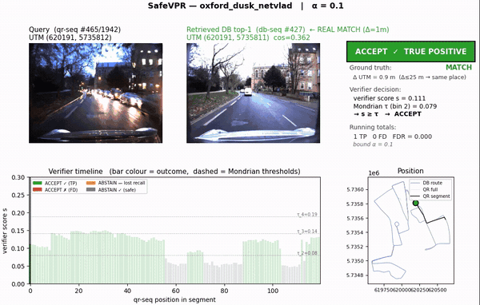
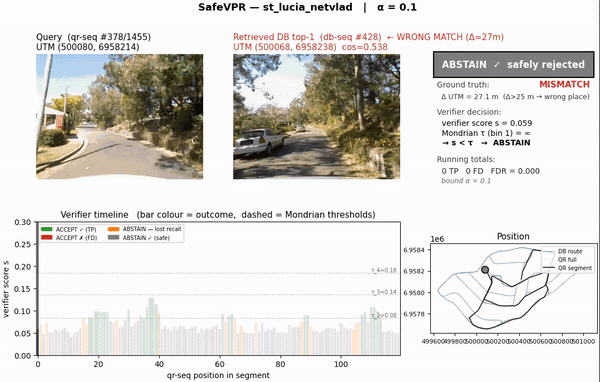

# SafeVPR

**Patch-Based Conformal Verification for Safe Cross-Condition Sequence Visual Place Recognition**

SafeVPR turns any black-box sequence retrieval into a *safe* accept/reject
decision. Each frame below is one query decision under cross-condition shift.

**Accept a correct match** — Oxford RobotCar, dusk: the verifier score clears
the per-bin threshold, so the localization is used.



**Abstain on a wrong match** — St Lucia, morning↔noon: the retrieved top-1 is
49 m away; the verifier score falls below the threshold, so SafeVPR safely
rejects instead of accepting the error.



## 1. Overview

Visual place recognition (VPR) systems must decide not only *where* a query was
taken but also *whether to trust* that decision. Under condition shift (day vs.
night, season changes, weather) the raw retrieval similarity is a poor proxy for
correctness, so a fixed similarity threshold cannot guarantee a bounded
false-discovery rate (FDR).

SafeVPR is a three-stage, backbone-agnostic pipeline that adds a *safe*
accept/reject decision on top of any black-box sequence retrieval:

1. **Stage 1 — Retrieval (black box).** A frame-level similarity matrix is reduced
   to a per-database-window diagonal-mean cosine score, pre-screened, and
   re-ranked by DTW alignment to produce a top-1 candidate.
2. **Stage 2 — Verifier (ours).** DINOv2 ViT-L/14 patch features of the `T=10`
   diagonal frame pairs are matched with a mutual-nearest-neighbour + Lowe-ratio
   test, yielding a scalar verification score `s` in `[0, 1]`.
3. **Stage 3 — Conformal calibration (ours).** A Mondrian conformal Learn-Then-Test
   (LTT) procedure fits a per-quintile-bin threshold with a Bonferroni-split error
   budget, controlling FDR at a target `alpha`.

**Key claim:** conformal validity decouples from raw discrimination — a verifier
with higher AUROC is *not* automatically safer; the calibrator is what controls
FDR. SafeVPR reaches 23/23 valid cross-condition setups at `alpha = 0.10`.

## 2. Installation

```bash
pip install -e .
```

Requires Python 3.10+ and PyTorch (CPU is sufficient for the smoke test; a GPU is
needed for full extraction). DINOv2 ViT-L/14 is fetched via `torch.hub` on first
use, or you can point to a local checkpoint.

## 3. Data & weights

SafeVPR ships **code only** — no datasets, weights, or precomputed results.

| Dataset | Role | Expected path key (in `configs/paths.yaml`) |
|---|---|---|
| Oxford RobotCar | cross-condition (day/night/rain/dusk) | `datasets.oxford_robotcar` |
| NCLT | campus, perceptual aliasing | `datasets.nclt` |
| St Lucia | morning vs. noon | `datasets.st_lucia` |

| Weights | Notes |
|---|---|
| DINOv2 ViT-L/14 | verifier backbone; `weights.dinov2: null` auto-downloads via `torch.hub` |
| NetVLAD / CosPlace / D2VPR | black-box Stage-1 backbones (cosine retrieval) |

Copy the template and fill in the paths (the real file is git-ignored):

```bash
cp configs/paths.example.yaml configs/paths.yaml
```

## 4. Quick start

Run the accept/abstain decision on synthetic data — no images, GPU, or datasets:

```bash
python demo.py
```

It calibrates the Mondrian conformal thresholds and prints the controlled FDR,
the TPR, and example per-query ACCEPT / ABSTAIN decisions.

### Using the library on your own data

```python
from safevpr.verifier import load_dinov2, verify_pair
from safevpr.conformal import fit_mondrian_ltt, accept
from safevpr.metrics import fdr, tpr

# Stage 2 — score each (query window, candidate window) pair of T frames
model = load_dinov2()                       # frozen DINOv2 ViT-L/14
s = verify_pair(model, q_frames, c_frames)  # patch-MNN + Lowe score in [0, 1]

# Stage 3 — calibrate on a labelled split, then decide on new queries
thresholds = fit_mondrian_ltt(cal_scores, cal_correct, alpha=0.10)
decision   = accept(test_scores, thresholds)   # True = accept, False = abstain
print("FDR", fdr(test_correct, decision), "TPR", tpr(test_correct, decision))
```

## 5. Reproducing the main result

The headline cross-condition result (23/23 valid setups at `alpha = 0.10`, mean
accepted FDR 0.014, mean TPR 0.75) is reproduced in two steps. First extract the
Stage-2 verifier score for each `<dataset>_<condition>_<backbone>` setup (needs
the datasets + a GPU; DINOv2 is fetched via `torch.hub`):

```bash
python scripts/extract_scores.py --config oxford_night_cosplace
# ... repeat per setup; each writes results/verifier_scores/<setup>.npz ...
```

Then calibrate and evaluate (CPU, seconds):

```bash
python scripts/evaluate.py --score-cache results/verifier_scores \
    --out results/cross_condition.json
```

This prints, for each `alpha`, the number of valid setups under both the global
LTT and the Mondrian calibrator. The comparison baselines (AnyLoc-VLAD,
SuperPoint+LightGlue) and the secondary analyses (robustness, pose-error,
runtime, sensitivity) are reported in the paper; this release ships the method
and the main cross-condition evaluation.

## 6. Method → code map

| Stage | Module | Public functions |
|---|---|---|
| 1. Retrieval (black box) | `safevpr/retrieval.py`, `safevpr/dtw.py` | `diagonal_mean_scores`, `dtw_rerank`, `top_candidates` |
| 2. Verifier (ours) | `safevpr/verifier.py` | `load_dinov2`, `extract_patch_features`, `mnn_lowe_ratio`, `verify_pair` |
| 3. Conformal calibration (ours) | `safevpr/conformal.py` | `quintile_bins`, `fit_mondrian_ltt`, `accept`, `calibrate_ltt` |
| Metrics | `safevpr/metrics.py` | `fdr`, `tpr`, `coverage`, `auroc` |
| Evaluation glue | `safevpr/evaluation.py` | `evaluate_setup`, `collect_calibration`, `collect_test` |

Numerical core (fixed): `T_FRAMES = 10`, Lowe `RATIO_THRESH = 0.9`,
`PATCH_DIM = 1024`, DINOv2 ViT-L/14 at 224×224 with ImageNet normalization;
Mondrian `N_BINS = 5`, LTT Bonferroni `GRID_M = 5`, `DELTA = 0.05`,
`ALPHAS = (0.05, 0.10)`, per-bin `tau`.

## 7. Repo layout

```
SafeVPR/
├── safevpr/                 # importable library (the "ours" contribution)
│   ├── retrieval.py         # Stage 1: diagonal-mean cosine + DTW re-rank
│   ├── dtw.py               # DTW alignment + path features
│   ├── verifier.py          # Stage 2: DINOv2 patch-MNN + Lowe-ratio score
│   ├── conformal.py         # Stage 3: Mondrian conformal LTT
│   ├── metrics.py           # FDR / TPR / coverage / AUROC
│   ├── evaluation.py        # calibrate-then-evaluate glue
│   └── datasets/            # Oxford / NCLT / St Lucia loaders
├── scripts/
│   ├── extract_scores.py    # Stage-2 verifier extraction (per setup, GPU)
│   └── evaluate.py          # cross-condition calibrate + FDR/TPR/validity
├── configs/                 # paths.example.yaml + per-dataset YAML
├── tests/                   # zero-data smoke test + parity tests
└── assets/                  # README demo GIFs
```

## 8. Citation

```bibtex
@article{safevpr2026,
  title   = {Patch-Based Conformal Verification for Safe Cross-Condition
             Sequence Visual Place Recognition},
  author  = {Anonymous},          % TODO camera-ready
  journal = {Under review},       % TODO camera-ready
  year    = {2026}
}
```

## 9. License

MIT — see [`LICENSE`](LICENSE).
