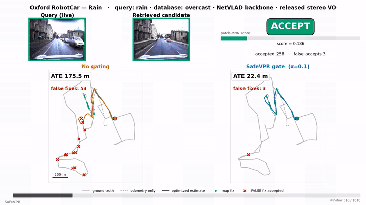

# SafeVPR

**Patch-Based Verification with Empirical FDR Control for Cross-Condition Sequence Visual Place Recognition**

[](https://hasar12138.github.io/SafeVPR/)
[](https://arxiv.org/abs/2605.28048)
[](https://hasar12138.github.io/SafeVPR/)
[](LICENSE)



SafeVPR decides whether a robot should accept a retrieved place-recognition match. It scores the match by frozen DINOv2 patch agreement and calibrates a per-bin accept threshold with Mondrian conformal Learn-Then-Test, so a target false-discovery rate holds on conditions never seen in calibration: **23/23** held-out cross-condition setups at α = 0.10, and in pose-graph relocalization **29.6× fewer** erroneous loop closures with median trajectory error cut from **95.5 m to 9.7 m**. The control is empirical, measured on these deployments, not a formal guarantee under arbitrary shift.

**Method, interactive demos, results and video: [project page](https://hasar12138.github.io/SafeVPR/).**

## News

- **2026-10** Accepted to IEEE Robotics and Automation Letters (RA-L). [Project page](https://hasar12138.github.io/SafeVPR/) online.
- **2026-05** Preprint on [arXiv](https://arxiv.org/abs/2605.28048); code released.

## Installation

```bash
pip install -e .
```

Requires Python 3.10+ and PyTorch (CPU is sufficient for the smoke test; a GPU is
needed for full extraction). DINOv2 ViT-L/14 is fetched via `torch.hub` on first
use, or you can point to a local checkpoint.

## Quick start

Run the cross-condition accept/abstain decision on a bundled sample of **real**
verifier scores (the eight CosPlace-backbone deployments) — no images, GPU, or
full datasets:

```bash
python demo.py
```

For each deployment it calibrates the Mondrian conformal thresholds on the
*other* deployments and evaluates the held-out one (calibration and test never
share a condition), printing the leave-one-out validity (8/8 with FDR ≤ alpha),
then a detailed view of a hard deployment with example ACCEPT / ABSTAIN
decisions.

### Using the library on your own data

```python
from safevpr.verifier import load_dinov2, verify_pair
from safevpr.conformal import fit_mondrian_ltt, accept
from safevpr.metrics import fdr, tpr

# Stage 2 — score each (query window, candidate window) pair of T frames
model = load_dinov2()                       # frozen DINOv2 ViT-L/14
s = verify_pair(model, q_frames, c_frames)  # patch-MNN + Lowe score in [0, 1]

# Stage 3 — calibrate on a labelled split, then decide on new queries
thresholds = fit_mondrian_ltt(cal_scores, cal_correct, alpha=0.10)
decision   = accept(test_scores, thresholds)   # True = accept, False = abstain
print("FDR", fdr(test_correct, decision), "TPR", tpr(test_correct, decision))
```

<details>
<summary><b>Data &amp; weights</b></summary>

SafeVPR ships **code only** — no datasets, weights, or precomputed results.

| Dataset | Role | Expected path key (in `configs/paths.yaml`) |
|---|---|---|
| Oxford RobotCar | cross-condition (day/night/rain/dusk) | `datasets.oxford_robotcar` |
| NCLT | campus, perceptual aliasing | `datasets.nclt` |
| St Lucia | morning vs. noon | `datasets.st_lucia` |

| Weights | Notes |
|---|---|
| DINOv2 ViT-L/14 | verifier backbone; `weights.dinov2: null` auto-downloads via `torch.hub` |
| NetVLAD / CosPlace / D2VPR | black-box Stage-1 backbones (cosine retrieval) |

Copy the template and fill in the paths (the real file is git-ignored):

```bash
cp configs/paths.example.yaml configs/paths.yaml
```

</details>

<details>
<summary><b>Reproducing the main result</b></summary>

The headline cross-condition result (23/23 valid setups at `alpha = 0.10`, mean
accepted FDR 0.014, mean TPR 0.75) is reproduced in two steps. First extract the
Stage-2 verifier score for each `<dataset>_<condition>_<backbone>` setup (needs
the datasets + a GPU; DINOv2 is fetched via `torch.hub`):

```bash
python scripts/extract_scores.py --config oxford_night_cosplace
# ... repeat per setup; each writes results/verifier_scores/<setup>.npz ...
```

Then calibrate and evaluate (CPU, seconds):

```bash
python scripts/evaluate.py --score-cache results/verifier_scores \
    --out results/cross_condition.json
```

This prints, for each `alpha`, the number of valid setups under both the global
LTT and the Mondrian calibrator. The comparison baselines (AnyLoc-VLAD,
SuperPoint+LightGlue) and the secondary analyses (robustness, pose-error,
runtime, sensitivity) are reported in the paper; this release ships the method
and the main cross-condition evaluation.

</details>

<details>
<summary><b>Method → code map and repo layout</b></summary>

| Stage | Module | Public functions |
|---|---|---|
| 1. Retrieval (black box) | `safevpr/retrieval.py`, `safevpr/dtw.py` | `diagonal_mean_scores`, `dtw_rerank`, `top_candidates` |
| 2. Verifier (ours) | `safevpr/verifier.py` | `load_dinov2`, `extract_patch_features`, `mnn_lowe_ratio`, `verify_pair` |
| 3. Conformal calibration (ours) | `safevpr/conformal.py` | `quintile_bins`, `fit_mondrian_ltt`, `accept`, `calibrate_ltt` |
| Metrics | `safevpr/metrics.py` | `fdr`, `tpr`, `coverage`, `auroc` |
| Evaluation glue | `safevpr/evaluation.py` | `evaluate_setup`, `collect_calibration`, `collect_test` |

Numerical core (fixed): `T_FRAMES = 10`, Lowe `RATIO_THRESH = 0.9`,
`PATCH_DIM = 1024`, DINOv2 ViT-L/14 at 224×224 with ImageNet normalization;
Mondrian `N_BINS = 5`, LTT Bonferroni `GRID_M = 5`, `DELTA = 0.05`,
`ALPHAS = (0.05, 0.10)`, per-bin `tau`.

```
SafeVPR/
├── safevpr/                 # importable library (the "ours" contribution)
│   ├── retrieval.py         # Stage 1: diagonal-mean cosine + DTW re-rank
│   ├── dtw.py               # DTW alignment + path features
│   ├── verifier.py          # Stage 2: DINOv2 patch-MNN + Lowe-ratio score
│   ├── conformal.py         # Stage 3: Mondrian conformal LTT
│   ├── metrics.py           # FDR / TPR / coverage / AUROC
│   ├── evaluation.py        # calibrate-then-evaluate glue
│   └── datasets/            # Oxford / NCLT / St Lucia loaders
├── scripts/
│   ├── extract_scores.py    # Stage-2 verifier extraction (per setup, GPU)
│   └── evaluate.py          # cross-condition calibrate + FDR/TPR/validity
├── configs/                 # paths.example.yaml + per-dataset YAML
├── examples/                # bundled real verifier scores for demo.py
├── tests/                   # zero-data smoke test + parity tests
└── assets/                  # README demo GIFs
```

</details>

<details>
<summary><b>Paper supplement</b></summary>

Additional tables and figures that accompany the paper (the manuscript
itself is self-contained and does not cite them) live in
[`docs/paper_supplement/`](docs/paper_supplement/) (PDF + LaTeX source +
PNG preview for each item):

| Item | Content |
|------|---------|
| [S1 — per-setup table](docs/paper_supplement/README.md#s1-per-setup-detail-table-23-setups) | All 23 setups: sizes, accepts, false accepts, FDR/TPR/coverage, fitted thresholds |
| [S2 — score-shift / KS analysis](docs/paper_supplement/README.md#s2-cal-vs-test-score-distributions-ks-analysis) | Cal-vs-test distributions for four verifiers; KS does not predict validity |
| [S3 — bootstrap CIs](docs/paper_supplement/README.md#s3-per-setup-bootstrap-confidence-intervals) | Per-setup bootstrap FDR confidence intervals |
| [S4 — runtime breakdown](docs/paper_supplement/README.md#s4-runtime-stage-breakdown) | Per-query latency stages (53.1 ms total) |
| [S5 — learned re-ranker](docs/paper_supplement/README.md#s5-learned-re-ranker-negative-result) | Negative result: learned scores fail cross-condition FDR control |
| [S6 — pose-error table](docs/paper_supplement/README.md#s6-metric-pose-error-admissibility-table) | Metric validity variant, 20/20 valid for tau_p in {5, 10, 25} m |
| [S7 — full verifier sweep](docs/paper_supplement/README.md#s7-verifier-x-calibrator-sweep--full-table-both-alpha-levels) | Verifier x calibrator sweep at both alpha levels |
| [S8 — calibration-budget numbers](docs/paper_supplement/README.md#s8-calibration-budget-ablation-numbers) | Subsampled calibration pools: validity kept, coverage lost below ~150/bin |

</details>

## Citation

```bibtex
@article{sier2026safevpr,
  title   = {{SafeVPR}: Patch-Based Conformal Verification for Safe
             Cross-Condition Sequence Visual Place Recognition},
  author  = {Sier, Ha and Zhang, Jiaqiang and Zou, Zhuo and Yu, Xianjia and Westerlund, Tomi},
  journal = {arXiv preprint arXiv:2605.28048},
  year    = {2026}
}
```

## License

MIT, see [`LICENSE`](LICENSE).
