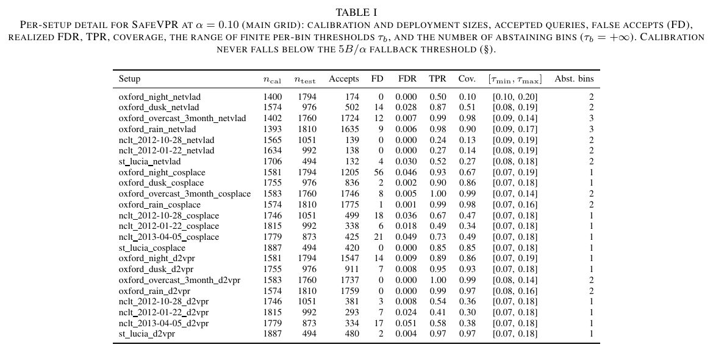
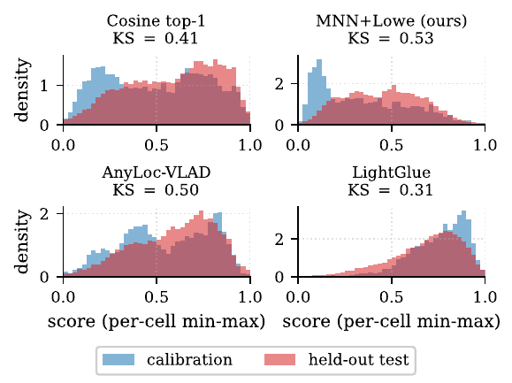
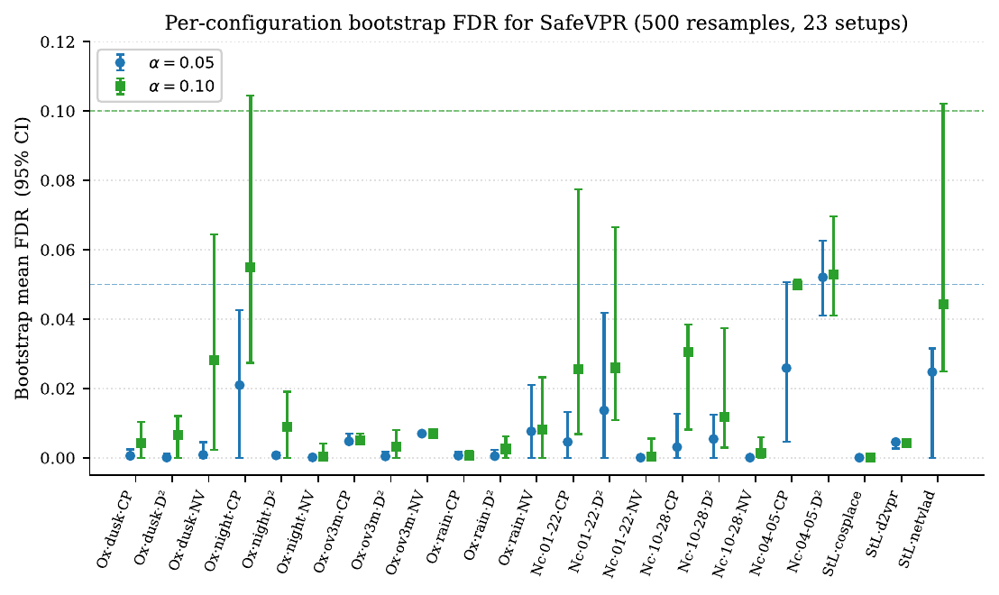
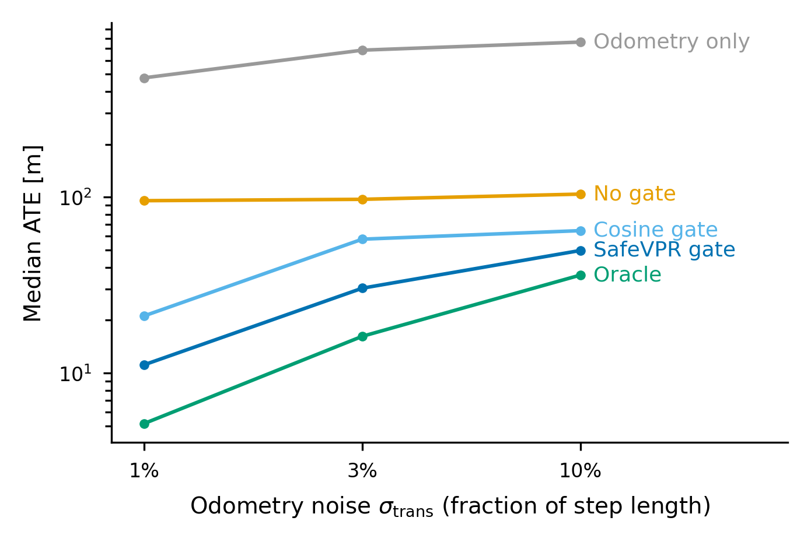
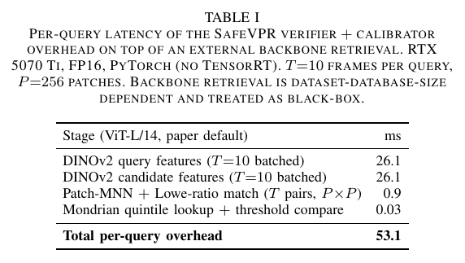
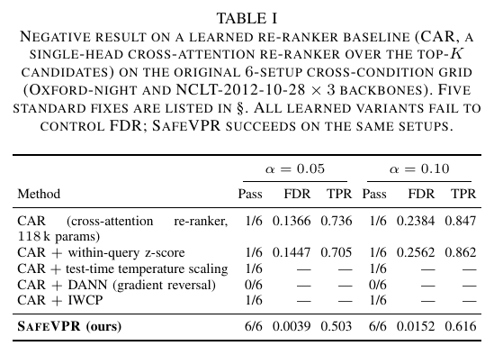
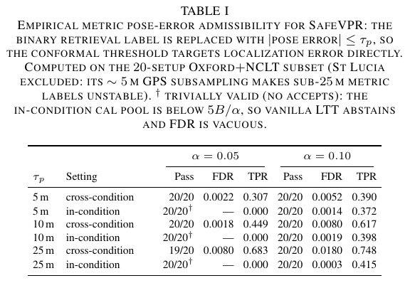
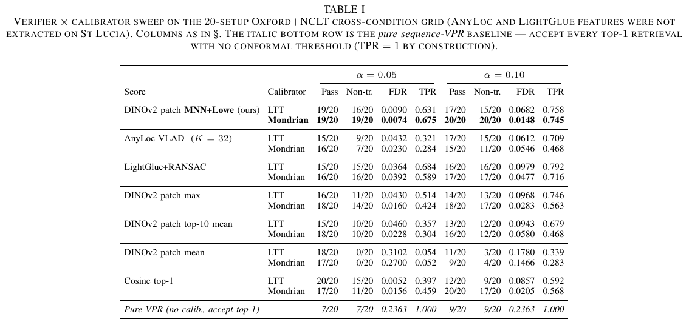

# SafeVPR — Paper Supplement

Supplementary material referenced from the paper as *"supplementary
material in the code repository"*. RA-L supplementary uploads are
restricted to multimedia, so the tabular and graphical supplements live
here. Every item below is also provided as a vector PDF (and, for
tables, the LaTeX source).

## S1. Per-setup detail table (23 setups)

Referenced from Sec. V-A and V-C. For every cross-condition setup at
α = 0.10: calibration/deployment sizes, accepted queries, false accepts
(FD), realized FDR, TPR, coverage, the range of fitted per-bin
thresholds, and the number of abstaining bins. Two checks it documents:
calibration pools (1393–1887 queries) never fall below the 5B/α
fallback thresholds (250/500), and the FD column totals 201 —
reconciling exactly with the closed-loop study (Table IV of the paper).

## S2. Cal-vs-test score distributions (KS analysis)

Referenced from Sec. V-B. Distributions for the four verifiers of
paper Table II, aggregated over the 20-setup common grid, with mean
per-cell Kolmogorov–Smirnov distances (cosine 0.41, MNN+Lowe 0.53,
AnyLoc 0.50, LightGlue 0.31). The lowest-KS score (LightGlue) is *not*
the most valid — raw distribution distance does not predict validity;
only the false-match rate inside the accepting bin does.

## S3. Per-setup bootstrap confidence intervals

Referenced from Sec. V-D (robustness probe *a*). Bootstrap mean FDR
with 95% CI per setup (500 calibration resamples). All 23 setups
satisfy the α = 0.10 target; only `nclt_2013-04-05_d2vpr` carries
non-negligible mass above the α = 0.05 line.

## S4. Odometry-noise sweep (closed-loop study)

Referenced from Sec. V-F. Median ATE over the 23 setups vs. simulated
odometry noise (1% / 3% / 10% of step length). The constraint-policy
ordering is stable across the 10× range; the no-gate curve is nearly
flat because its error is dominated by erroneous loop-closure
constraints, not odometry quality. (The paper's headline protocol uses
real sensor-stream odometry on all three platforms; this sweep is the
controlled-variable complement.)

## S5. Runtime stage breakdown

Referenced from Sec. VI-A. Per-query latency on an RTX 5070 Ti (FP16,
T = 10 frames, P = 256 patches): DINOv2 features 2×26.1 ms, patch-MNN +
Lowe matching 0.9 ms, Mondrian quintile lookup 0.03 ms — 53.1 ms total,
independent of database size.

## S6. Learned re-ranker negative result

Referenced from Sec. VI-C. A learned cross-attention re-ranker (CAR)
and five standard fixes (z-score normalisation, test-time temperature
scaling, alternative softmax scores, domain-adversarial training,
importance-weighted conformal prediction) all fail cross-condition FDR
control (1/6 valid) on the original 6-setup grid; SafeVPR passes on the
same setups. Any learned score that sees condition information during
training inherits a condition-dependent output distribution.

## S7. Metric pose-error admissibility table

Referenced from Sec. V-E. The metric validity variant (label
= |pose error| <= tau_p) on the densely-GPSed Oxford+NCLT subset:
20/20 valid at alpha = 0.10 for every tau_p in {5, 10, 25} m.

## S8. Verifier x calibrator sweep — full table (both alpha levels)

Referenced from Sec. V-B (the paper shows the alpha = 0.10 block).
Full sweep including the alpha = 0.05 block for all seven verifier
scores x two calibrators, plus the pure-VPR baseline.

## S9. Calibration-budget ablation (numbers)

Referenced from Sec. VI-B. Subsampled calibration pools, 10 seeds per
size, all 23 setups, alpha = 0.10. Validity is retained in >= 98.7% of
runs at every size; the cost of small pools is coverage:

| n_cal | non-trivial coverage | mean TPR |
|------:|---------------------:|---------:|
| >= 700 (~140/bin) | 100% of runs | 0.69 |
| 400 | 93% | 0.60 |
| 250 (Mondrian boundary 5B/alpha) | 75% | 0.50 |
| 150 (vanilla-LTT fallback) | comparable | 0.55 |
| ~50 | collapses toward global abstention | — |

Deployment guideline: budget >~ 150 labelled calibration queries per
bin; expect coverage loss, not FDR violation, below that.
